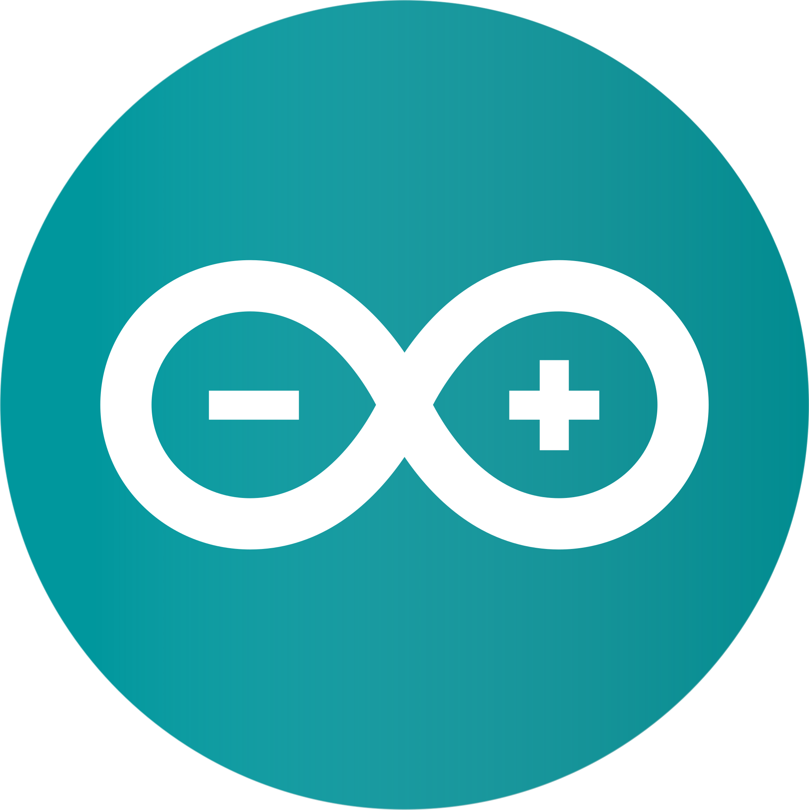
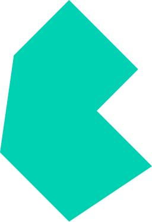

<h1 align="center">Hi 👋, I'm Shamsad</h1>
<h3 align="center">A web tech enthusiast</h3>

<!-- 
  
 -->

-   🔭 I’m currently working on [SafwahMart](http://safwahmart-dev.appinionbd.com/)

-   🌱 I’m currently learning **Laravel**

-   👯 I’m looking to collaborate on [NextJs](https://nextjs.org/)

-   🤝 I’m looking for help with [Laravel](https://laravel.com/)

-   💬 Ask me about **Nuxt, Vue, React, NextJS**

-   📫 How to reach me **hi@shamsad.com**

-   📄 Know about my experiences [View PDF](https://drive.google.com/file/d/1L6vZGzFrhVx7i_5qkiUd78-ZQU8Wwuwe/view?usp=sharing)

### Blogs posts

<!-- BLOG-POST-LIST:START -->
<!-- BLOG-POST-LIST:END -->

<h3 align="left">Connect with me:</h3>

    
    
    
    
    <!--  -->

  
<h3 align="left">Languages and Tools:</h3> 

  
  
  
  
  
  
  
  
  
  
  
  
  
  
  
  
  
  
  
  
  
  
  
  
  
  
  
  
  
  
  
  

<!-- 
&nbsp;
 -->

